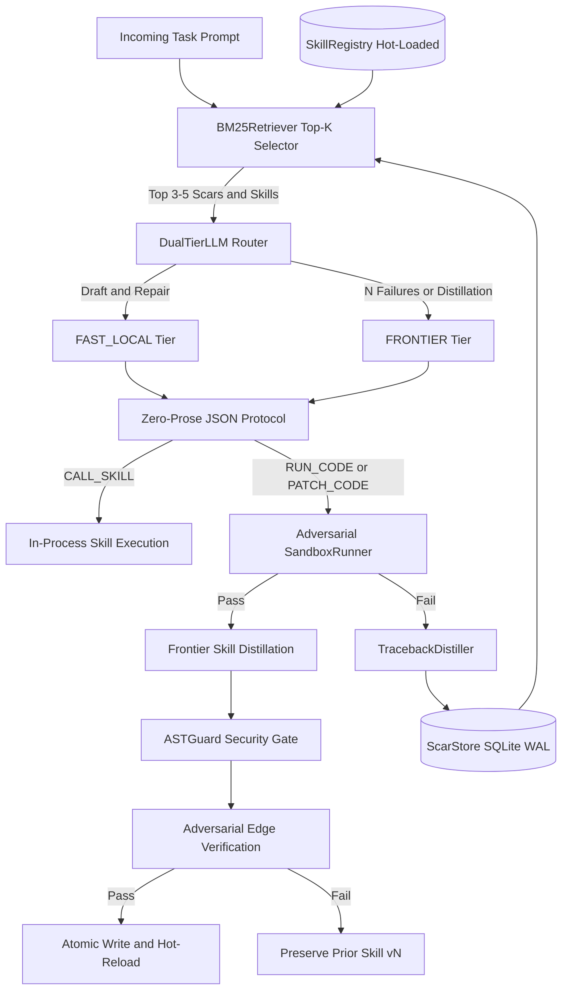
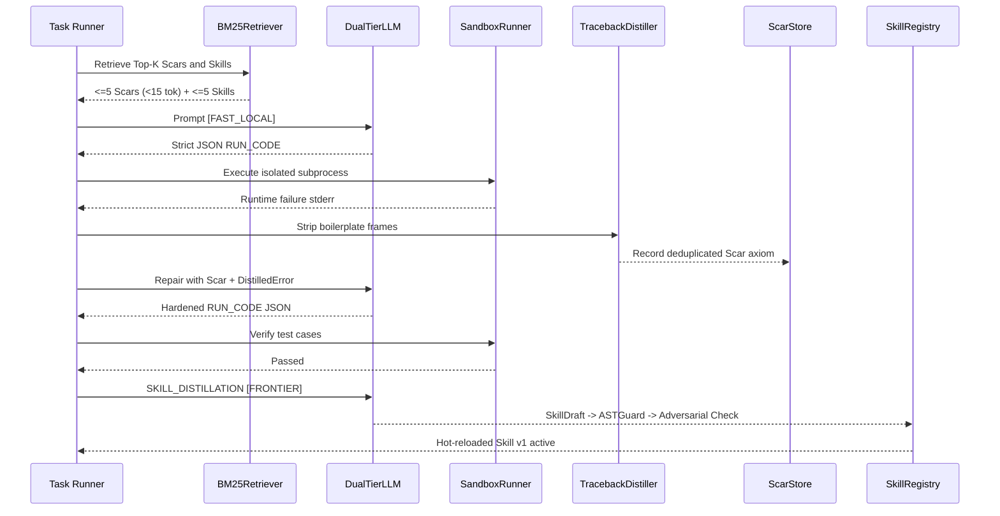
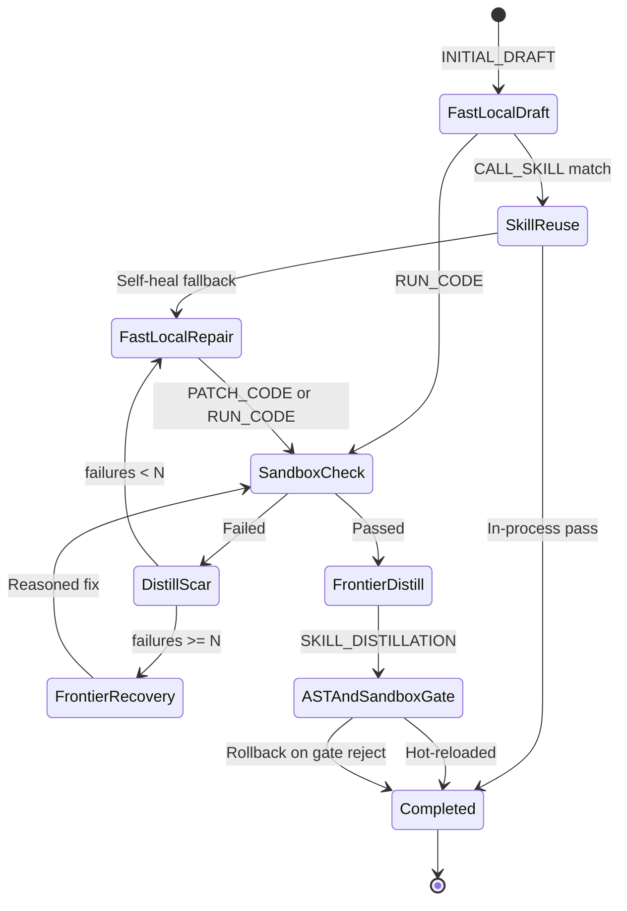

# Scar-Forge

**Scar-Forge** is a self-evolving Python AI Agent engine that learns from runtime failures (**Scars**) and dynamically compiles solved tasks into AST-verified, hot-reloadable executable tools (**Skills**).

---

## Core Architecture

Scar-Forge closes the execution loop across three core pillars and five token-saving mechanisms:

1. **Failure-to-Axiom Engine (`ScarStore`)**: Every runtime failure is distilled into a deduplicated, telegraphic **Negative Axiom** (`< 15` subword tokens, e.g. `[AVOID] DataFrame.append -> [USE] pd.concat`) backed by SQLite WAL + atomic JSON mirroring and 3-stage deduplication (exact hash, structural match, token Jaccard).
2. **AST-Verified Skill Forging & Hot-Reload (`ASTGuard` + `SkillRegistry`)**: Solved tasks are refactored into standalone, PEP-484/604 typed Python functions, validated by `ASTGuard` (allowlisted imports only, zero dangerous builtins/dunders/stubs), adversarially verified in `SandboxRunner`, persisted atomically, and hot-reloaded in-process with versioned module namespaces (immune to `.pyc` staleness).
3. **Adversarial Verification Sandbox (`SandboxRunner`)**: Untrusted code and forged skills run inside an isolated subprocess with stripped environment variables, isolated temporary working directory, Win32 Job Object containment (`KILL_ON_JOB_CLOSE`, active process cap, commit cap), `psutil` RSS + `tracemalloc` allocation guards, runtime import blocks, and synthesized boundary/edge test inputs.



### Closed-Loop Learning Sequence



### Dual-Tier Model Routing & State Lifecycle



---

## Five Token-Saving Mechanisms

| Mechanism | Module | Runtime Guarantee |
| --- | --- | --- |
| **1. Top-K Dynamic Context Injection** | `scar_forge.memory.retriever` | BM25+ + tag/name hybrid retrieval clamped strictly to `1..5` items (`top_k=4` default). Never dumps the full Scar DB or Skill catalog. |
| **2. Telegraphic Scar Compression** | `scar_forge.tokens` | Deterministic subword counter (`deterministic_subword_regex_v1`) enforces `< 15` tokens (`<= 14`) per `[AVOID] X -> [USE] Y` or `[RULE] X` axiom. |
| **3. Stderr & Traceback Distiller** | `scar_forge.distiller` | Strips ANSI codes, debug/info logs, site-packages/stdlib frames, and wrapper boilerplate; preserves exception type, core message, failing line, and aligned syntax carets. |
| **4. Tiered Model Escalation** | `scar_forge.llm.adapter` | Routes drafts, syntax repairs, and initial test loops to `FAST_LOCAL` (Ollama/local); escalates to `FRONTIER` (Gemini/OpenAI) after `escalation_threshold` consecutive failures or for `SKILL_DISTILLATION`. |
| **5. Zero-Prose Structured Protocol** | `scar_forge.protocol` | Rejects conversational prose outside JSON schemas (`RUN_CODE`, `CALL_SKILL`, `PATCH_CODE`, `FINAL_ANSWER`) and supports CRLF-safe unified diffs, line-range edits, and search/replace blocks. |

---

## 3-Epoch Benchmark Results

Executed via `python scripts/run_benchmark.py --provider local --mode variant` across 8 real-world Python pitfall domains (`pandas_concat`, `iso_utc_delta`, `csv_bom_parse`, `json_strict_rfc8259`, `webhook_bool_coerce`, `semver_numeric_sort`, `html_text_extract`, `posix_path_guard`):

- **Tokenizer:** `deterministic_subword_regex_v1`
- **Epoch 3 vs Epoch 1 Token Reduction:** **80.2%**
- **Epoch 2 Repeated Error Reduction:** **100.0%**
- **Epoch 3 vs Epoch 1 Speedup:** **47.00x**

| Epoch | Passed | Accuracy | Total Tokens | Avg Tokens/Task | Total Errors | Repeated Errors | Duration (ms) | Active Scars | Active Skills | Skill Reuses |
| --- | ---: | ---: | ---: | ---: | ---: | ---: | ---: | ---: | ---: | ---: |
| Epoch 1 (Cold Start) | 8/8 | 100.0% | 12,690 | 1586.2 | 8 | 0 | 22,219.2 | 8 | 8 | 0 |
| Epoch 2 (Scar-Guided) | 8/8 | 100.0% | 3,326 | 415.8 | 0 | 0 | 6,782.7 | 8 | 8 | 0 |
| Epoch 3 (Skill-Reuse) | 8/8 | 100.0% | 2,507 | 313.4 | 0 | 0 | 472.7 | 8 | 8 | 8 |

### Per-Task Progression

| Task ID | Epoch 1 Tokens (Errors) | Epoch 2 Tokens (Repeated) | Epoch 3 Tokens (Skill Reused) | Token Savings (E3 vs E1) |
| --- | ---: | ---: | ---: | ---: |
| `pandas_concat` | 1,372 (1) | 368 (0) | 377 (`merge_dataframe_records`) | 72.5% |
| `iso_utc_delta` | 1,506 (1) | 370 (0) | 378 (`compute_utc_deltas`) | 74.9% |
| `csv_bom_parse` | 1,843 (1) | 485 (0) | 371 (`parse_bom_semicolon_csv`) | 79.9% |
| `json_strict_rfc8259` | 1,738 (1) | 484 (0) | 311 (`serialize_strict_json`) | 82.1% |
| `webhook_bool_coerce` | 1,381 (1) | 337 (0) | 317 (`coerce_webhook_booleans`) | 77.0% |
| `semver_numeric_sort` | 1,301 (1) | 310 (0) | 255 (`sort_semver_tags`) | 80.4% |
| `html_text_extract` | 1,772 (1) | 489 (0) | 248 (`extract_html_text`) | 86.0% |
| `posix_path_guard` | 1,777 (1) | 483 (0) | 250 (`resolve_safe_posix_path`) | 85.9% |

---

## Quickstart & CLI Reference

### Installation

```bash
python -m venv .venv
.venv\Scripts\activate  # or: source .venv/bin/activate
pip install -e ".[dev]"
```

### CLI Subcommands (`scar-forge` / `python -m scar_forge`)

| Command | Purpose | Example |
| --- | --- | --- |
| `demo` | Showcase cold failure -> Scar -> Skill forge -> reuse | `scar-forge demo --provider local` |
| `run` | Execute a single task through the closed loop | `scar-forge run --task "Merge list of record dicts into DataFrame" --json` |
| `benchmark` | Run the 8-task 3-Epoch benchmark (`variant`, `standard`, `ablation`) | `scar-forge benchmark --mode variant --out bench.json --md-out bench.md` |
| `inspect` | View persisted Scars, Skills, and run history | `scar-forge inspect --kind all --json` |
| `search` | Query Top-K (`1..5`) Scars and Skills via BM25 | `scar-forge search "DataFrame" --top-k 4 --json` |
| `dashboard` | Start the local Flask observability web dashboard | `scar-forge dashboard --host 127.0.0.1 --port 8765` |

### Standalone Benchmark & Tests

```bash
# Run standalone 3-Epoch benchmark
python scripts/run_benchmark.py --provider local --mode variant --out bench.json --md-out bench.md

# Run full test suite (unit + 4-tier E2E + static hygiene)
pytest

# Run linter on source, scripts, and unit tests
ruff check src scripts tests/test_static_hygiene.py tests/test_memory_sandbox.py tests/test_forge_llm_engine.py tests/test_benchmark_cli_ui.py
```

---

## Repository Layout

```text
scar_forge/
├── pyproject.toml
├── requirements.txt
├── README.md
├── scripts/
│   └── run_benchmark.py
├── src/scar_forge/
│   ├── __init__.py          # Public exports & lazy Layer 2 resolution
│   ├── __main__.py          # python -m scar_forge entrypoint
│   ├── cli.py               # Click CLI (demo, run, benchmark, inspect, search, dashboard)
│   ├── config.py            # EngineConfig & UTF-8 console setup
│   ├── models.py            # Pydantic v2 schemas & enums
│   ├── tokens.py            # Deterministic subword counter & <15 token axiom gate
│   ├── protocol.py          # Zero-Prose JSON parser & CRLF-safe code patcher
│   ├── distiller.py         # Stderr/traceback frame & log distiller
│   ├── memory/
│   │   ├── scar_store.py    # SQLite WAL Scar persistence & 3-stage deduplication
│   │   └── retriever.py     # BM25+ + tag/name hybrid Top-K selector
│   ├── sandbox/
│   │   └── runner.py        # Isolated subprocess, Win32 Job, RSS/tracemalloc, adversarial tests
│   ├── forge/
│   │   ├── sanitizer.py     # ASTGuard security, typing, docstring, zero-stub validator
│   │   └── registry.py      # Atomic Skill persistence & hot-reload without .pyc staleness
│   ├── llm/
│   │   ├── adapter.py       # DualTierLLM small-to-large escalation router
│   │   ├── local_solver.py  # Deterministic Zero-Prose solver backend
│   │   └── providers.py     # Ollama, Gemini, and OpenAI provider adapters
│   ├── agent/
│   │   └── engine.py        # Closed-loop ScarForgeEngine
│   ├── benchmark/
│   │   ├── tasks.py         # 8-task benchmark suite
│   │   └── runner.py        # 3-Epoch benchmark runner & Markdown reporter
│   └── ui/
│       ├── console.py       # Rich CLI formatters
│       └── dashboard.py     # Flask local web UI & JSON REST APIs
└── tests/
    ├── test_static_hygiene.py
    ├── test_foundation_distiller.py
    ├── test_memory_sandbox.py
    ├── test_forge_llm_engine.py
    ├── test_benchmark_cli_ui.py
    └── e2e/
        ├── conftest.py
        ├── test_tier1_features.py
        ├── test_tier2_boundaries.py
        ├── test_tier3_combinations.py
        └── test_tier4_workflows.py
```
